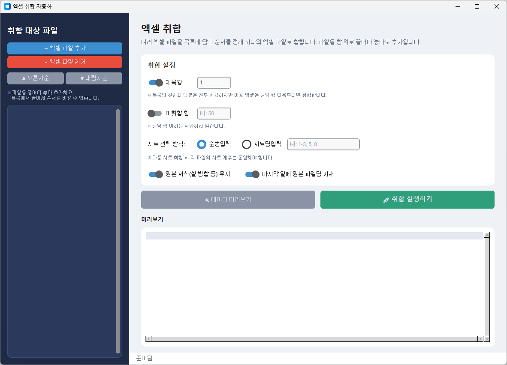

# 📊 엑셀 취합 자동화

### 👉 [📥 다운로드 및 실행 방법](docs/실행방법.md)

여러 개의 엑셀 파일을 **하나의 엑셀 파일로 합쳐 주는** Windows용 프로그램입니다.
복잡한 설정 없이, 파일을 창 위로 끌어다 놓고 **취합 실행하기** 버튼만 누르면 됩니다.

> 현재 버전: **1.0.0**



---

## 📖 간단 사용법

1. 프로그램을 실행하고, 엑셀 파일을 창 위로 끌어다 놓거나 **＋ 엑셀 파일 추가** 버튼을 누릅니다.
2. 왼쪽 목록에서 파일 순서를 정합니다. (끌어서 이동 / 오름차순 / 내림차순)
3. **취합 설정**(제목행, 미취합 행, 시트, 서식 등)을 정합니다.
4. **🔍 데이터 미리보기**로 결과를 확인한 뒤, **🚀 취합 실행하기**를 누릅니다.
5. 저장 위치를 고르면 새 엑셀 파일(기본 이름 `취합완료.xlsx`)이 만들어집니다.

### 자주 쓰는 팁
- **여러 파일 한꺼번에 추가하기**: 파일을 여러 개 선택해서 한 번에 끌어다 놓으세요.
- **순서 바꾸기**: 목록에서 파일을 마우스로 끌어 옮기면 됩니다. `Ctrl` / `Shift`로 여러 개를 골라 함께 옮길 수도 있습니다.
- **목록에서 빼기**: 파일을 고르고 `Delete` 키 또는 **－ 엑셀 파일 제거** 버튼을 누릅니다.
- **먼저 확인하기**: 실행 전에 **데이터 미리보기**를 누르면 앞쪽 파일 3개의 결과 모양을 미리 볼 수 있습니다.

---

## ⚙️ 취합 설정 안내

| 설정 | 설명 |
|---|---|
| **제목행** | 제목(머리글)이 있는 행 번호를 입력합니다. 목록의 **첫 번째 엑셀은 제목행까지 전부** 가져오고, **두 번째부터는 제목행 다음 행부터만** 가져옵니다. 끄면 모든 행을 그대로 가져옵니다. |
| **미취합 행** | 입력한 행 **이하는 취합하지 않습니다.** (예: `50` 입력 시 50행부터는 제외) 제목행보다 큰 숫자여야 합니다. |
| **시트 선택 방식** | **순번입력**: `1-3, 5, 8` 처럼 시트 순서로 지정합니다.<br>**시트명입력**: `1월, 2월, 3월` 처럼 시트 이름으로 지정합니다. |
| **원본 서식(셀 병합 등) 유지** | 글꼴·테두리·배경색·표시 형식과 셀 병합을 그대로 가져옵니다. |
| **마지막 열에 원본 파일명 기재** | 각 행이 어느 파일에서 왔는지 맨 오른쪽 열에 적어 줍니다. |

- 데이터 중간에 있는 **빈 행은 지우지 않고 그대로** 가져옵니다. (맨 아래쪽의 빈 행만 제외)
- 시트를 여러 개 취합하면, **같은 순번(또는 이름)의 시트끼리** 각각 합쳐져 결과 파일에도 시트가 여러 개 만들어집니다.

---

## ⚠️ 알아두실 점

- **다중 시트 취합** 시에는 모든 파일의 **시트 개수가 같아야** 합니다. 다르면 안내 창이 뜹니다.
- 결과 파일은 항상 **새 파일**로 저장되며, 원본 엑셀의 내용은 바뀌지 않습니다.
- 열리지 않는 파일(손상되었거나 `.xls` 형식 등)은 **엑셀이 자동으로 복구**를 시도하며, 같은 폴더에 `파일명_복구됨.xlsx`가 만들어질 수 있습니다. 이 기능은 **Microsoft Excel이 설치되어 있어야** 동작합니다.
- 읽기 전용으로 설정된 파일은 목록에 추가할 때 **읽기 전용 속성이 해제**됩니다.
- 엑셀에서 열려 있는 임시 파일(`~$`로 시작하는 파일)은 자동으로 제외됩니다.
- 파일이 많거나 용량이 크면 시간이 다소 걸릴 수 있습니다. 아래쪽 **상태 표시줄**에서 진행 상황을 볼 수 있습니다.

---

## ✨ 주요 기능

- 여러 엑셀 파일(`.xlsx` `.xls`)을 **하나의 파일로 취합**
- 파일을 창 위로 **끌어다 놓기(드래그 앤 드롭)** 로 추가
- 파일 목록: 마우스로 순서 변경, `Delete` 키로 삭제, 이름 오름차순 / 내림차순 정렬
- 제목행 지정, 미취합 행 지정, 시트 순번·이름 지정
- 원본 서식 및 셀 병합 유지
- 마지막 열에 원본 파일명 기재
- 취합 전 **데이터 미리보기**
- 손상된 엑셀 파일 **자동 복구** 후 취합

---

## 💻 사용 환경

- **Windows 10 / 11** (64비트)
- **Microsoft Excel** 설치 (손상 파일·`.xls` 자동 복구 기능에 필요)

---

## 🛠️ 소스코드로 실행하기 (선택)

파이썬이 설치되어 있다면 아래 순서로 직접 실행할 수도 있습니다.

```
pip install customtkinter openpyxl pywin32 tkinterdnd2
python excel_consolidator.py
```

---

## 📝 버전 이력

전체 버전 이력은 **[이력.md](docs/이력.md)** 에서 확인하실 수 있습니다.

---

## 🙋 문의 및 오류 제보

사용 중 불편한 점이나 오류가 있다면 [Issues](../../issues) 에 남겨 주세요.
오류 메시지 화면과 어떤 작업을 하던 중이었는지 함께 적어 주시면 큰 도움이 됩니다.

---

## 📜 라이선스

<!-- 사용하실 라이선스를 정한 뒤 이 부분을 채워 주세요. -->

### 사용한 오픈소스

| 라이브러리 | 라이선스 |
|---|---|
| [openpyxl](https://openpyxl.readthedocs.io/) | MIT |
| [CustomTkinter](https://github.com/TomSchimansky/CustomTkinter) | MIT |
| [tkinterdnd2](https://github.com/Eliav2/tkinterdnd2) | MIT |
| [pywin32](https://github.com/mhammond/pywin32) | PSF |
